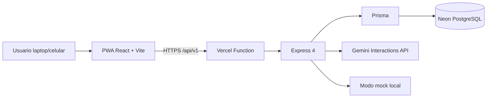

# 💰 SmartFinance AI

> Dashboard financiero personal con inteligencia artificial para Peru.  
> Registra gastos en lenguaje natural, escanea boletas, controla presupuestos y recibe predicciones en soles.

<p align="center">
  <a href="https://github.com/ihvalverde/Smartfinance-AI"></a>
  
  
  
  
  
  
  
  
</p>

---

## ✨ Que hace SmartFinance AI

SmartFinance AI convierte el caos financiero diario en un panel claro y accionable. Pensado para uso real en laptop y celular, con tema claro/oscuro y experiencia instalable como app.

| Modulo | Capacidades |
| --- | --- |
| 🔐 Auth | Registro/login, JWT access + refresh cookie httpOnly, perfil editable |
| 🏦 Cuentas | CRUD, saldos, resumen consolidado |
| 🏷️ Categorias | Sistema + personalizadas, jerarquicas, ocultar/restaurar sin perder historial |
| 💳 Transacciones | CRUD con filtros, transferencias atomicas con `transferPairId` |
| 🎯 Presupuestos | CRUD, estado por periodo, alertas de exceso |
| 📊 Dashboard | Resumen mensual, gastos por categoria, tendencias 30d/6m, movimientos recientes, diagnostico IA |
| 🤖 IA | Categorizacion por lenguaje natural, escaneo de boletas, predicciones, chat financiero con historial |
| 📱 PWA | Instalable en laptop y celular, service worker, cache del shell |

---

## 🖼️ Vistas

> Agrega aqui tus capturas en `docs/screenshots/` y actualiza las rutas.

```text
docs/screenshots/
  dashboard.png
  transactions.png
  chat.png
  mobile.png
```

---

## 🧱 Stack tecnologico

| Capa | Tecnologias |
| --- | --- |
| Frontend | React 18, Vite 5, Tailwind CSS 3, Recharts, Zustand, Axios, React Router 6, Lucide, date-fns, React Hot Toast |
| Backend | Node.js, Express 4 (ESM), Prisma 5.22, PostgreSQL 16 (Neon), JWT + bcryptjs, Zod, Multer, Helmet, express-rate-limit |
| IA | Google Gemini via Interactions API (REST), modo `mock` sin API key |
| Deploy | Vercel (frontend estatico + Express serverless) + Neon PostgreSQL |
| PWA | Manifest, service worker, iconos 192/512 |

---

## 🏗️ Arquitectura



---

## 📁 Estructura del proyecto

```text
SmartFinance-AI/
├── api/
│   └── index.js                 # Funcion serverless que exporta Express
├── client/
│   ├── public/
│   │   ├── favicon.svg
│   │   ├── icons/               # Iconos PWA 192 y 512
│   │   ├── manifest.webmanifest # Manifest PWA
│   │   └── sw.js                # Service worker
│   └── src/
│       ├── components/          # UI, layout, charts, forms por dominio
│       ├── pages/               # Dashboard, Transactions, Accounts, ...
│       ├── stores/              # auth.store, theme.store
│       └── lib/                 # api, utils
├── server/
│   ├── prisma/
│   │   ├── schema.prisma
│   │   ├── migrations/
│   │   └── seed.js
│   └── src/
│       ├── config/
│       ├── controllers/
│       ├── middlewares/
│       ├── routes/
│       ├── services/            # dominio + ai/
│       ├── utils/
│       └── validators/
├── docs/
├── package.json                 # Workspaces: server + client
└── vercel.json
```

---

## 🚀 Inicio rapido

### 1) Instalar dependencias

```bash
npm install
```

### 2) Configurar entorno

```bash
cp .env.example .env
```

En Windows PowerShell:

```powershell
Copy-Item .env.example .env
```

Completa en `.env`:

- `DATABASE_URL` (Neon pooled)
- `DIRECT_URL` (Neon directa)
- `JWT_ACCESS_SECRET`, `JWT_REFRESH_SECRET`
- `AI_PROVIDER` (`mock` o `gemini`)
- `GEMINI_API_KEY` (solo si usas Gemini)

### 3) Base de datos y datos demo

```bash
npm run db:deploy
npm run db:seed
```

### 4) Ejecutar

```bash
npm run dev
```

- Frontend: http://localhost:5173
- API: http://localhost:3000/api/v1
- Health: http://localhost:3000/api/health

### Credenciales demo

```text
Email:    carlos@demo.com
Password: Demo1234!
```

---

## 📱 PWA: instalacion en celular

En produccion (HTTPS en Vercel):

- **Android (Chrome/Edge):** menu -> Instalar aplicacion.
- **iPhone (Safari):** Compartir -> Agregar a inicio.
- **Laptop (Chrome/Edge):** icono de instalacion en la barra.

El service worker cachea el shell para carga rapida. Las llamadas a la API siempre van a la red.

---

## 🌐 Despliegue en Vercel + Neon

1. Crea la base en Neon y copia las cadenas pooled y directa.
2. Importa el repositorio en Vercel.
3. Configura Environment Variables (Production y Preview):

```text
DATABASE_URL
DIRECT_URL
JWT_ACCESS_SECRET
JWT_REFRESH_SECRET
JWT_ACCESS_EXPIRES_IN=15m
JWT_REFRESH_EXPIRES_IN=7d
GEMINI_API_KEY
GEMINI_MODEL=gemini-3.8-flash
AI_PROVIDER=gemini
NODE_ENV=production
CLIENT_URL=https://tu-dominio.vercel.app
```

4. El build ejecuta `npm run vercel-build`:
   - `prisma generate`
   - `prisma migrate deploy`
   - build del cliente

5. Carga datos demo si los quieres:

```bash
npm run db:seed
```

Ejecutalo desde tu maquina apuntando a la base de produccion.

---

## 📡 API principal

Base: `/api/v1`. Todas las rutas salvo auth requieren `Authorization: Bearer <accessToken>`.

| Recurso | Endpoints |
| --- | --- |
| Auth | `POST /auth/register`, `POST /auth/login`, `POST /auth/refresh`, `POST /auth/logout`, `GET/PATCH /auth/me` |
| Cuentas | `GET/POST /accounts`, `GET /accounts/summary`, `GET/PATCH/DELETE /accounts/:id` |
| Categorias | `GET/POST /categories`, `GET /categories/tree`, `POST /categories/restore-hidden` |
| Transacciones | `GET/POST /transactions`, `POST /transactions/transfer`, `GET/PATCH/DELETE /transactions/:id` |
| Presupuestos | `GET/POST /budgets`, `GET /budgets/status`, `PATCH/DELETE /budgets/:id` |
| Dashboard | `GET /dashboard/summary`, `/expenses-by-category`, `/trends`, `/recent`, `/diagnosis` |
| IA | `GET /ai/status`, `POST /ai/categorize`, `POST /ai/scan-receipt`, `GET /ai/predictions`, `GET/POST/DELETE /ai/chat/*` |

Respuesta exitosa:

```json
{ "status": "success", "data": {} }
```

---

## 🔒 Seguridad

- `.env` no se sube al repositorio.
- Secretos JWT distintos para access y refresh.
- Refresh token en cookie `httpOnly`, `secure` en produccion, `sameSite=lax`, rotacion y hash SHA-256 en BD.
- Contrasenas con bcrypt (12 rondas).
- Cada recurso valida pertenencia al usuario autenticado.
- `GEMINI_API_KEY` solo en backend y variables de entorno.

---

## 🧪 Tests

```bash
npm test
```

---

## 🛠️ Scripts

| Comando | Descripcion |
| --- | --- |
| `npm run dev` | Backend con `--watch` + Vite en paralelo |
| `npm run dev:server` | Solo backend |
| `npm run dev:client` | Solo frontend |
| `npm run build` | Build de produccion del cliente |
| `npm run vercel-build` | Prisma generate + migrate deploy + build |
| `npm run db:generate` | Genera Prisma Client |
| `npm run db:migrate` | Migraciones en desarrollo |
| `npm run db:deploy` | Aplica migraciones pendientes |
| `npm run db:seed` | Carga categorias y datos demo |
| `npm run db:studio` | Abre Prisma Studio |
| `npm run db:reset` | Borra y recrea la base (solo desarrollo) |

---

## 🆘 Solucion de problemas

- **`P1012 Environment variable not found: DIRECT_URL`**: falta `DIRECT_URL` en `.env` raiz o en Vercel.
- **`prisma migrate deploy` falla**: verifica cadena sin `-pooler` y base accesible.
- **Seed no conecta**: confirma `.env` en la raiz.
- **IA en modo local**: `AI_PROVIDER=mock`, falta `GEMINI_API_KEY` o Gemini saturado.
- **Cookies no persisten**: usa HTTPS en produccion y mismo dominio.
- **PWA no se instala**: verifica HTTPS, manifest valido, iconos 192/512 y service worker registrado.

---

<p align="center">
  Hecho con ❤️ para finanzas personales en soles peruanos.
</p>
